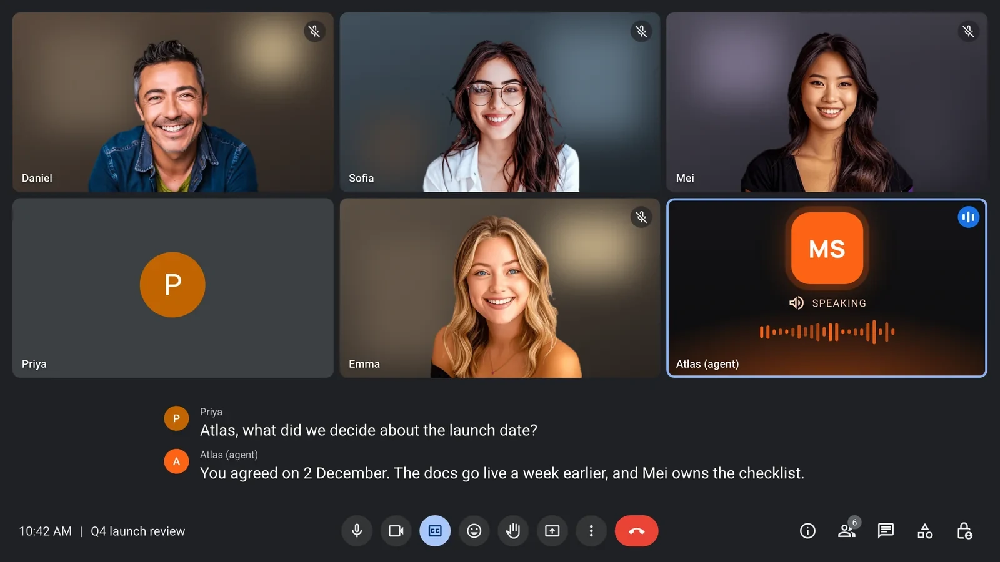
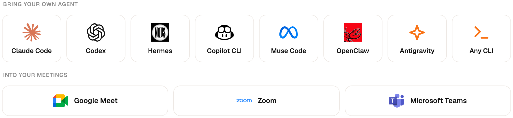
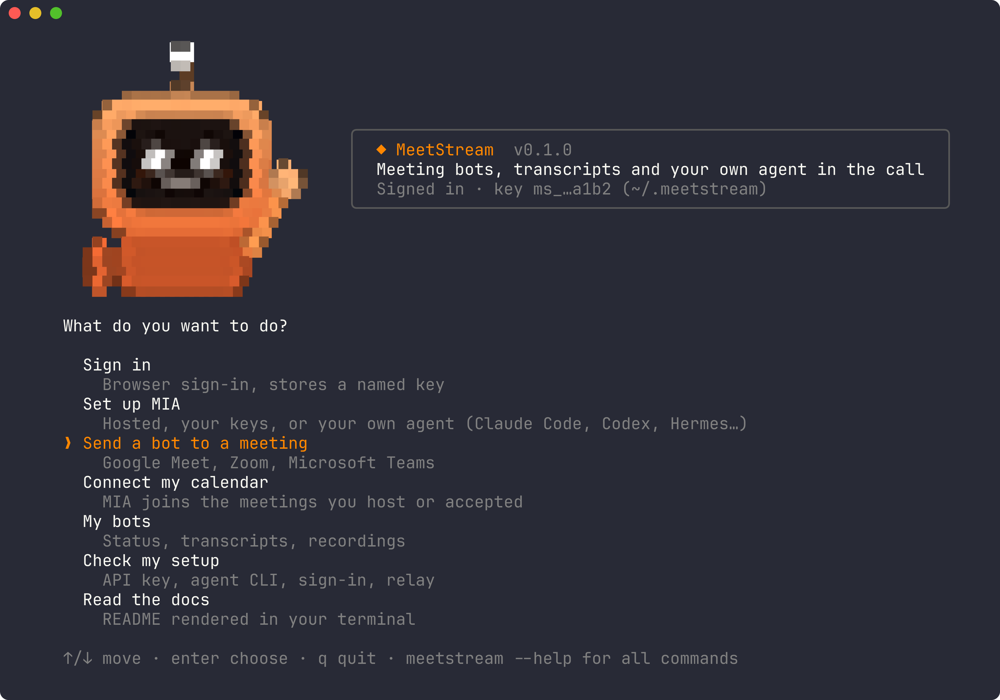

<div align="center">

# MeetStream CLI

**Make your own note-taker, or let your agent join the call.**

Still pasting meeting transcripts into Claude? Bring your own agent into Google Meet, Zoom and Teams:<br>
build your own note-taker, or send Claude Code, Codex or Hermes to listen, act on your tools and answer live.<br>
Your prompts, your rules. One command.

[](LICENSE)




</div>

`meetstream` is one small binary. It replaces two earlier tools:
`@meetstream/cli` (Node) and `meetstream-agent-kit` (Python). Install it from
whichever package manager you already use. Every package ships the same Go binary.

<picture>
  <source media="(prefers-color-scheme: dark)" srcset="docs/images/agents-dark.png">
  
</picture>



## Contents

- [Install](#install)
- [Quick start](#quick-start)
- [Commands](#commands)
- [For scripts and agents](#for-scripts-and-agents)
- [Configuration](#configuration)
- [Status](#status)
- [Development](#development)

## Install

Install from whichever package manager you already use:

| You have | Run |
|---|---|
| Node | `npm install -g @meetstream/cli` or `npx @meetstream/cli` |
| Python | `pipx install meetstream-cli` or `uvx --from meetstream-cli meetstream` |
| Homebrew | `brew install meetstream-ai/tap/meetstream` |
| Nothing | download a binary from [Releases](https://github.com/meetstream-ai/cli/releases) |

Each package carries the binary for your platform: macOS, Linux or Windows, on
amd64 or arm64. Nothing is downloaded at install time. On PyPI the package is
`meetstream-cli`; the command is still `meetstream`.

**Sign in.** `meetstream login` opens your browser. If browser sign-in isn't available, `login`
says so and takes a pasted key instead. You can also set the key directly:

```bash
meetstream auth set-key                                # hidden prompt
printf %s "$MEETSTREAM_API_KEY" | meetstream auth set-key  # from stdin
```

**From source:**

```bash
git clone https://github.com/meetstream-ai/cli.git meetstream-cli && cd meetstream-cli
make install            # builds and installs ~/.local/bin/meetstream
make smoke              # version, doctor, and the key in use
```

## Quick start

```bash
meetstream            # the home screen: pick what to do
meetstream doctor     # check your key, config and agent CLIs
meetstream login      # sign in with your browser
meetstream join https://meet.google.com/abc-defg-hij
```

No key yet? Create one at [app.meetstream.ai/api-keys](https://app.meetstream.ai/api-keys)
and set `MEETSTREAM_API_KEY`.

## Commands

| Command | What it does | Status |
|---|---|---|
| `meetstream` | Home screen: an arrow-key menu of the common tasks | ✅ |
| `doctor` | Checks the API key, then your agent CLI: installed (also off PATH), signed in, warm (ACP) session, this computer's relay connection, folder and meeting context; prints a verdict and exits 1 when a check fails (`--agent`, `--binary`, `--no-warm`) | ✅ |
| `auth status` / `auth logout` | Checks the key in use with the API (masked; `--offline` skips the check) / removes the stored one | ✅ |
| `docs` | Shows this README in your terminal | ✅ |
| `skill` | Prints [SKILL.md](SKILL.md) for coding agents | ✅ |
| `version` | Shows version, commit and platform | ✅ |
| `login` | Signs in with your browser and stores a named API key, which is never shown (`--with-key` reads one from stdin for CI); in a terminal, then offers to connect your calendar (`--no-calendar` skips) | ✅ |
| `join <url>` | Sends a bot to a meeting (all `create_bot` options) | ✅ |
| `bots list/status/get/timeline/remove/delete/say/show-image/hand` | Manages your bots (old `bot …` names still work) | ✅ |
| `bots tail` | Planned: live bot events over the relay; exits 2 with a local receiver hint | planned |
| `init` | Starts a project from a template (notetaker, send a bot, live captions, webhook receiver; Python or Node). Asks step by step in a terminal (Esc goes back); every question is also a flag (`--yes --no-input` for agents). Writes `.env` (no MeetStream key on a laptop; `--with-key` for servers) and an `AGENTS.md` | ✅ |
| `env` | Fills `.env` from `.env.example` and lists the keys still empty (`--check`). No MeetStream key goes in by default (apps use your CLI sign-in); `--with-key` adds it for a server | ✅ |
| `api <path>` | One MeetStream API call with your sign-in (`-X`, `-d`, `--envelope`); the init apps use it on your laptop | ✅ |
| `join --transcription` / `--live-transcription` / `--follow` | Choose the transcript after the call or live (`transcription providers` lists them; live sends sentence mode, `--transcription-mode raw\|word_level` changes it); `--follow` prints each status change, then waits for the transcript | ✅ |
| `listen` | Local webhook receiver; loopback by default, `--forward-to` your app (signature headers kept), `--tunnel cloudflared\|ngrok\|https://…` for a public URL. While it runs, `join` sends bot events to it | ✅ |
| `trigger <event>` | Sends a sample webhook (production envelope) to your app | ✅ |
| `mock` | Local fake MeetStream API with scenarios: build and test with no bots and no charges | ✅ |
| `ai install` | Installs the MeetStream skill and the hosted MCP into Claude Code, Codex and Cursor | ✅ |
| `commands --json` | Every command, flag, choice and exit code, for agents | ✅ |
| `logins teams/google` | Manages domains and signed-in accounts; passwords from stdin, environment or hidden prompt | ✅ |
| `calendar connect` | One-click Google calendar sign-in in your browser (Microsoft coming); turns on auto-join (`--join-rule accepted` (default): meetings you host or accepted; `all`: every meeting with a link). `--own-app` keeps the bring-your-own OAuth app flow | ✅ |
| `calendar list/events/schedule/unschedule/auto-join/reschedule/cancel` | Manages calendar bots (`auto-join off` turns auto-join off) | ✅ |
| `mia apply -f config.json` | Creates or updates an agent; `--dry-run` prints the body offline | ✅ |
| `mcp add claude/codex/cursor/vscode` | Prints hosted OAuth MCP setup; `--write` merges Codex/Cursor/VS Code configs with a backup | ✅ |
| `transcript <bot-id>` | Prints the transcript | ✅ |
| `recordings <bot-id>` | Prints audio and video links | ✅ |
| `balance` | Shows your prepaid balance | ✅ |
| `mia list/get/create/update/delete/check` | Manages MIA agent configs and checks the local bridge | ✅ |
| `setup` (= `agent setup`) | Step 1 asks how MIA runs in your meetings: MeetStream hosted, MIA with your keys (BYOK), your agent on your computer, or all local (preview, not available yet). Each option shows its price per hour for your account, as a breakdown (meeting, MIA harness, ears, brain, voice); prices are shown in setup and come from the API, never from the CLI. Then the chosen branch: hosted names and creates the agent; BYOK picks ears, brain and voice for your own keys (add them in the dashboard; setup never asks for keys); your agent picks the agent CLI (installs it if missing), its model and effort, MeetStream or your own keys for ears and voice, and connects this computer. Optionally connect your calendar last. Esc or "← Back" goes back on every step. `--mode hosted\|byok\|local-agent` (default local-agent), `--voice-keys meetstream\|own`, `--ears/--brain/--voice provider:model`, `--model`, `--effort`, `--no-calendar`, `--dry-run` (the request and its price); with `--no-input` it never asks and uses the flags or the defaults | ✅ |
| `agent bench` | Measures your agent's models: one short real meeting turn each, a few at a time, as tokens and API-rate cost per hour of meeting (live table in a terminal; Esc stops and keeps finished results). `--compare` measures the CLI's own list, `--models a,b`, `--parallel N`, `--effort`, `--export file` writes a model-estimates.json. For CLIs that report token usage (Claude Code, Codex, Antigravity, Hermes) | ✅ |
| `agent serve` | Runs your agent for MIA over the MeetStream relay (no tunnel); `--no-relay --tunnel …` to self-host | ✅ |
| `agent login` / `logout` / `status` | This computer's relay sign-in (shared with the Python kit) | ✅ |
| `agent context show|edit` | What your agent reads in meetings (MEETING.md) | ✅ |

## For scripts and agents

Every command accepts:

- `--json`: prints JSON on stdout. `listen` emits one JSON line per event; `bots status --watch` emits successive values. Human messages go to stderr.
- `--no-input`: never prompts. Where a command would ask, it exits with code 2 and a hint.
- `--no-color` (or `NO_COLOR=1`): plain text output.

Exit codes: `0` ok, `1` runtime or API error, `2` usage error or missing auth,
`3` not ready or not available, `4` transcript failed, `130` interrupted. These are the same codes as `@meetstream/cli`. With `--json`, errors are JSON too:

```json
{ "error": { "message": "not signed in", "hint": "run: meetstream login", "exit_code": 2 } }
```

Coding agents can read [SKILL.md](SKILL.md), or run `meetstream skill`.

## Configuration

| Where | What |
|---|---|
| `MEETSTREAM_API_KEY` | API key. It wins over the config file. |
| `~/.meetstream/config.json` | Stored key (`api_key`, `api_key_name`). Directory 0700, file 0600. The same file the Node CLI uses. |
| `MEETSTREAM_API_URL` | API base URL (default `https://api.meetstream.ai/api/v1`). |
| `MEETSTREAM_AUTH_URL` | Sign-in server (default `https://mcp.meetstream.ai`). |
| `MEETSTREAM_MASCOT=off` | Hides MIA. |
| `MEETSTREAM_TELEMETRY=0` (or `DO_NOT_TRACK=1`) | Turns off the anonymous usage event (see Telemetry). |

The CLI never prints or logs your key. Status output shows only the last four characters.

## Status

Everything in the command table marked ✅ works today. Planned next: `bots tail` over the relay
and `agent pair/list/revoke` for tunnel mode.
`meetstream` replaces `@meetstream/cli` and `meetstream-agent-kit`; both keep working during the switch.

## Telemetry

The CLI sends one **anonymous** usage event per command: the command name, the CLI version,
your OS and CPU type, and a hashed computer id. It never sends your API key, meeting URLs,
transcripts, flags or any other content. It is the same event `@meetstream/cli` 0.x sent.
Turn it off any time:

```bash
export MEETSTREAM_TELEMETRY=0   # or the standard DO_NOT_TRACK=1
```

## Development

```bash
go test ./...
go build -o dist-local/meetstream ./cmd/meetstream
goreleaser release --snapshot --clean     # all six platforms into dist/
python3 scripts/pack.py npm  0.1.0-dev       # npm launcher + 6 platform packages
python3 scripts/pack.py pypi 0.1.0-dev       # 6 platform wheels
```

Built with [Cobra](https://github.com/spf13/cobra),
[Bubble Tea](https://github.com/charmbracelet/bubbletea),
[Lip Gloss](https://github.com/charmbracelet/lipgloss) and
[Glamour](https://github.com/charmbracelet/glamour).

## License

Apache-2.0
